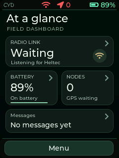

# Heltec LoRa Interface

A touchscreen and local web interface for a Heltec Meshtastic radio, built on
an ESP32-S3 CYD. Read messages, check radio and battery status, browse nodes,
and use offline maps without depending on internet access.

**Current firmware: v0.1.90.** The CYD runs this firmware; the Heltec runs
Meshtastic and handles the LoRa radio connection.

## What it does

- **Home dashboard:** radio status, battery level, node/GPS status and a message
  preview. Tap a card for details, or Menu for the launcher.
- **Messaging:** channel and direct messages, unread counts, delivery states,
  and retry controls where available.
- **Offline maps:** SD-backed maps on both the touchscreen and web interface,
  zooms 10–14, feet/miles scales and coarser fallback when detail is missing.
- **Map navigation:** drag to explore, pause/follow the device, recenter and
  inspect actual coverage around the touchscreen map center.
- **Battery monitoring:** optional MAX17048 fuel-gauge support, charging and
  low-battery status, and runtime estimates when enough discharge data exists.
- **Local storage:** chat/event logs, position history, saved location and a
  cached map image on MicroSD.
- **USB tools:** upload tiles, copy files to a replacement card and inspect
  receiver-level GPS diagnostics.



The launcher contains Messages, Nodes, Map, TX Log and System. Health is under
System. See the [home dashboard guide](docs/HOME_DASHBOARD.md) for details.

## Hardware

The current build uses:

| Component | Purpose |
| --- | --- |
| [LCDWiki 2.8-inch ESP32-S3 display / CYD](https://www.lcdwiki.com/2.8inch_ESP32-S3_Display) | Touchscreen, web interface and SD storage |
| Heltec V3.2 running Meshtastic | LoRa radio |
| GY-NEO6MV2 GPS module | Location input shared by the Heltec and CYD |
| Single-cell rechargeable battery, 2500 mAh 18650 in this build | Portable power |
| TP4056 charger and MT3608 5V boost converter | Charging and boosted supply |
| MAX17048 fuel-gauge breakout, optional | Battery state measurement |
| FAT32 MicroSD card, optional | Offline maps and persistent logs |

The verified CYD has 16 MiB flash and 8 MiB PSRAM. Pin assignments below are
specific to this hardware. GPIO numbers are not physical header positions.

## Build and first connection

1. Install the pinned Arduino dependencies and board configuration from
   [docs/BUILD.md](docs/BUILD.md). LVGL and TFT_eSPI configuration files are
   included in the repository.
2. To customize the device identity and credentials, copy
   `config/device_config.example.h` to `config/device_config.local.h` and edit
   that local file. Git ignores it. Without it, the example configuration is used.
3. Wire and configure the Heltec serial connection as shown below. Enable its
   GPS and configure the GPS pins if the receiver is installed.
4. Build the CYD firmware without changing its version:

   ```powershell
   .\tools\build_ota_bin.ps1 -NoVersionBump
   ```

   The binary is written under `dist/`. You can also use Arduino IDE with the
   board settings documented in the build guide.
5. Flash the CYD, connect to its Wi-Fi access point, and open
   **http://192.168.4.1/**. In station mode, use its assigned local-network address.

With the unchanged example configuration, the Wi-Fi network is
`s3-lora-interface`, the Wi-Fi password is `setup1234`, and the web login is
`admin` / `setup1234`. Complete the first-run setup and change the password.
Custom configurations use their configured network name and credentials.

The web interface includes messaging, nodes, offline maps, health, settings,
SD downloads and firmware upload. The map library and stylesheet are bundled
in firmware, so the web map needs no internet access.

## Wiring

TX connects to RX: one board's transmit wire goes to the other's receive pin.
All boards share a common ground.

### Power and fuel gauge

The documented power path is battery → charger output → 5V boost converter.
The boosted rail supplies the Heltec `5V`, CYD `5V` and GY-NEO6MV2 breakout
`VCC`. The CYD USB port does not charge this project's battery; charging uses
the separate charger connection.

The MAX17048 measures the **raw cell**, before the boost converter:

| MAX17048 connection | Connect to |
| --- | --- |
| Cell positive | Raw battery positive |
| Cell negative / GND | Common ground |
| SDA | CYD GPIO16 |
| SCL | CYD GPIO15 |
| VCC | CYD 3V3, subject to the breakout's supply requirements |

The gauge uses I²C address `0x36`. Its battery reading does not measure the
boosted GPS supply rail. Without a gauge, the UI shows an unavailable reading.

### CYD ↔ Heltec serial

| CYD | Heltec |
| --- | --- |
| GPIO14 — RX | GPIO39 — TX |
| GPIO21 — TX | GPIO38 — RX |
| GND | GND |

In the Meshtastic serial module, set **Enabled**, **PROTO / Protobuf** mode,
**115200 baud**, **RX pin 38** and **TX pin 39**.

### GPS

Split the GPS transmit output so both boards can read it:

| GPS module | Connect to |
| --- | --- |
| TX | Heltec GPIO5 **and** CYD GPIO3 |
| RX | Heltec GPIO4 |
| VCC | Boosted 5V rail for the GY-NEO6MV2 breakout |
| GND | Common ground |

Enable GPS in Meshtastic Position settings and set **GPS RX pin 5** and
**GPS TX pin 4**. The CYD listens on GPIO3 at **9600 baud** and does not drive
the GPS RX line. The GPS and radio serial connections use different pins and
baud rates.

### Built-in MicroSD slot

| SD signal | CYD GPIO |
| --- | --- |
| CLK | 38 |
| CMD | 40 |
| D0 | 39 |
| D1 | 41 |
| D2 | 48 |
| D3 | 47 |

Use the CYD's built-in slot. These are CYD GPIO assignments, separate from
the similarly numbered Heltec pins.

## Offline maps

Place tiles on the SD card using this structure:

```text
/s3-lora/tiles/{zoom}/{x}/{y}.rgb565
```

Each tile is **256×256 RGB565, little-endian, exactly 131072 bytes**. Supported
zoom levels are **10–14**; lower numbers show a wider area. Preparing new maps
requires a suitable tile source; viewing installed maps is fully offline.

On the touchscreen, use −/+ to change zoom, drag to explore, and use Follow
or My location to resume tracking. Coverage reports installed tiles around the
current center at each level. The requested zoom is retained when a coarser
view is needed. Availability is checked from files, not inferred from a
download plan.

The browser uses the same SD tiles. It preserves your pan position during
status updates and provides My location, Show nodes and Refresh maps controls.
Its Touchscreen coverage card describes the touchscreen's last checked area;
the browser map has its own visible-tile status.

See [touchscreen navigation](docs/MAP_NAVIGATION.md),
[coverage and fallback](docs/MAP_COVERAGE.md), and
[offline browser maps](docs/WEB_OFFLINE_MAPS.md).

### Upload tiles over USB

Install `pyserial`, connect through the **CYD USB port**, and close other serial
monitors. Replace `COM12` and `H:` with the actual port and card-reader drive.

```powershell
python -m pip install pyserial
python tools/upload_tiles_usb.py --port COM12 --tiles H:\s3-lora\tiles
```

The tile folder must contain `z/x/y.rgb565`. Identical tiles are verified and
skipped; add `--overwrite` to replace different existing tiles. Transfers use
CRC checks and SD readback verification. Use `--dry-run` to validate local
paths and sizes without connecting.

For large map packs, downloading directly to a card in a USB reader avoids the
CYD transfer step. The USGS downloader supports resuming and a storage budget,
with a St. Paul-centered coverage profile. See the
[map transfer and replacement-card guide](docs/USB_MAP_TRANSFER.md) for tile
preparation, direct downloads, source attribution and safe stopping/resuming.

### Preserve files when changing cards

To copy supporting files while preparing a new map pack separately:

```powershell
python tools/copy_sd_usb.py --port COM12 --destination H:\ `
  --manifest build/sd-copy-H.jsonl --progress build/sd-copy-H.json `
  --exclude-path /s3-lora/tiles
```

This reads the installed card and preserves directory structure on the new
card. Omit `--exclude-path` to copy existing tiles too. Supporting files can
include chat history and saved locations. Shut down the CYD before swapping
cards, and keep the original card until the replacement is working.

## GPS diagnostics

Open **System → GPS** to inspect receiver bytes, valid NMEA sentences,
checksum errors and available satellite counts before a position fix. Unknown
satellite counts are distinct from zero.

Over the CYD USB connection, the `gps` command reports the same receiver health
and the Heltec's reported GPS pin settings. To record an observation:

```powershell
python tools/gps_diagnostics_usb.py --port COM12 --duration 35 --interval 5 `
  --output build/gps-observation.json
```

The packet-statistics **GPS / Positions** counter measures mesh position
messages, including other nodes. It is not a receiver-fix counter.

| Observation | Next checks |
| --- | --- |
| Receiver bytes stay at zero | GPS power, common ground and GPS TX → CYD GPIO3 |
| Bytes arrive, but valid NMEA does not increase | Baud rate, output protocol and signal integrity |
| Valid sentences arrive, but no fix | Outdoor sky visibility, antenna connection/orientation and GPS supply stability |

The latest recorded observation confirmed valid serial data and the expected
Heltec pin settings, but did **not** acquire a position fix. See
[GPS diagnostics and recorded findings](docs/GPS_DIAGNOSTICS.md) for details.

## Memory and development

Large UI buffers, logs and the map canvas use ESP32-S3 PSRAM. The optional
eight-tile cache holds **1 MiB** in PSRAM; display transfer buffers and task
stacks remain in internal RAM. See the
[measured cache profile](docs/MAP_CACHE_PROFILE.md) for timings and limits.

Build dependencies, verification commands, source layout and hardware checks
are documented in [docs/BUILD.md](docs/BUILD.md). Local device configuration,
generated build identity, binaries, logs and download progress remain outside
Git under the configured ignore rules.

The bundled Leaflet viewer retains its license in
[src/vendor/leaflet/LICENSE](src/vendor/leaflet/LICENSE).
