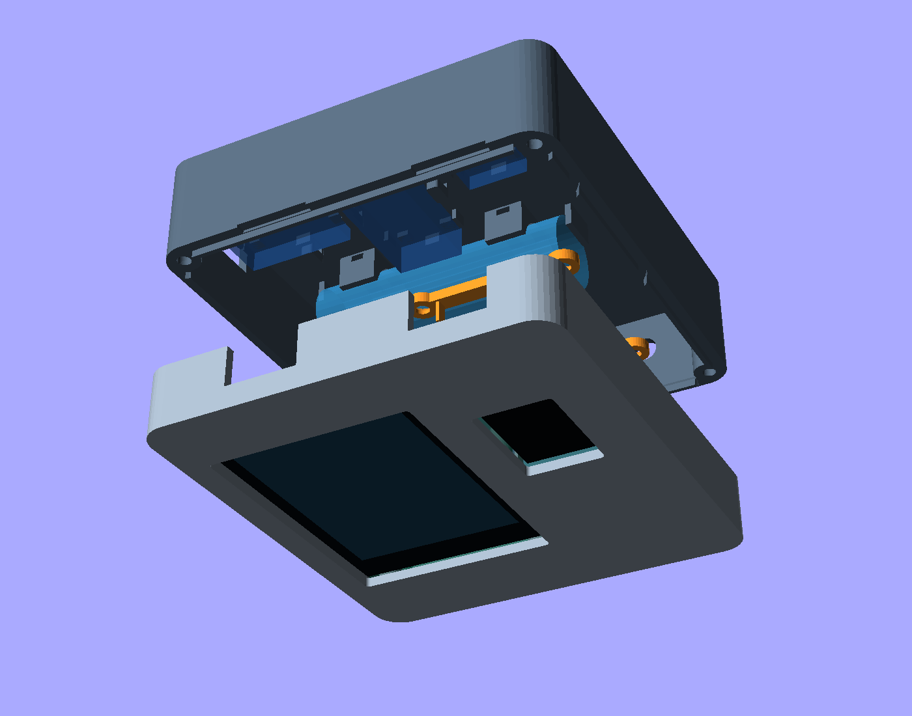
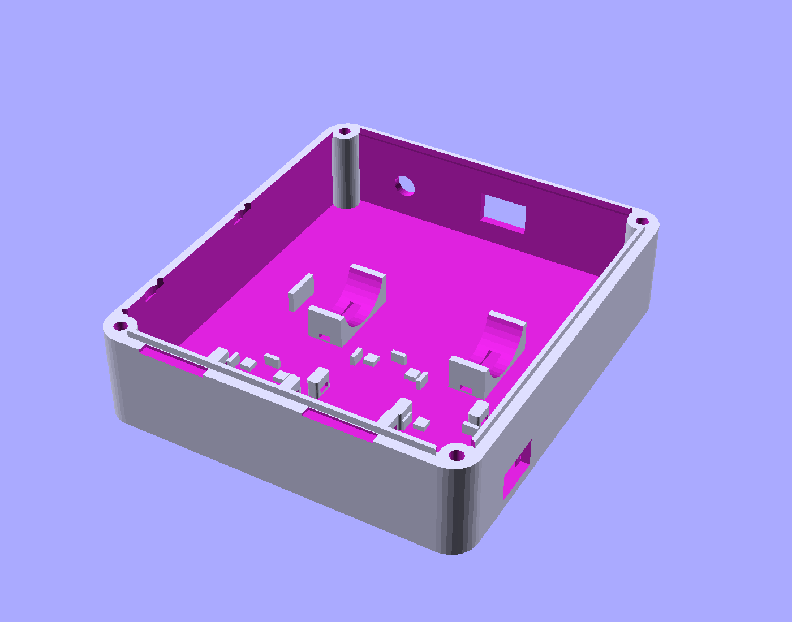

# V3 OpenSCAD enclosure

[Open the parametric model](../enclosure_v3.scad). V3 is a **mechanical prototype**;
manufacturer drawings establish the two main boards, but the installed small
modules, wiring and battery have not been measured. Print the fit coupon before
committing to the full case. [V2](../enclosure_v2.scad) remains unchanged.



## What changed after reviewing V2

- The CYD stack increases from the assumed 8 mm to **10.6 mm**, and the Heltec
  from 8 mm to **10.2 mm**. The CYD retains its verified 42 × 78 mm hole pitch.
- All parts, openings and previews share one assembly coordinate system. V2's
  front was mirrored in assembly while its component ghosts stayed in place.
- The V2 wire-channel expression evaluated to **−5 mm** at its defaults.
  V3 uses open space between modules rather than that solid feature.
- A 2.4 mm skin and walls replace the 1 mm skin / 1.6 mm walls. Two halves and
  an alignment lip replace the extra spacer. The lip has a tapered, connected
  root and clearance around the clamp ends.
- The battery has two curved saddles and strap tunnels. The small power boards
  have corner seats, locating fences and raised tie anchors.
- The Heltec has two removable clamps. The GPS board has upper edge keepers
  and a lower strap; the separate ceramic patch sits behind a closed plastic
  face, away from the power-board area.

The default outside shell is **100 × 112 × 42 mm**, excluding screw heads and
antenna hardware. This gives wiring and retention more room than V2; it is not
a reduction in outside size. The modeled bare cell has **6.1 mm** clearance to
the CYD envelope and **2.0 mm** to the top of the Heltec clamps. These figures
exclude unmeasured wire loops, headers and connector housings.

## Layout and access



Viewed from the front, with the antenna end at the top:

| Location | Component / access |
| --- | --- |
| Front left | CYD touchscreen, secured by its four PCB holes |
| Front lower right | Heltec with its OLED visible |
| Front upper right | GPS patch facing outward through plastic; GPS PCB behind it |
| Rear middle | Horizontal 18650, restrained by two nylon straps |
| Rear lower section | Charger, boost converter and fuel gauge |
| Bottom edge | Separate CYD and Heltec USB access openings |
| Left edge, near rear | Charger USB opening; this is the battery charging port |
| Top edge | Switch opening and SMA bulkhead hole |
| Rear upper left | Optional speaker space; mounting ring/grille disabled by default |

USB openings at the bottom are 18 × 11 mm to admit a plug housing into the
recess. Check the actual cables: the board edges are 11 mm from the outside
bottom, and a bulky housing may need a larger opening or a layout change.
Charger orientation is explicit: its long dimension runs left–right and its
USB connector faces the left wall.

MicroSD, boot/reset buttons and internal connectors are accessed by removing
the rear half. There is no external SD slot or waterproof seal. The CYD USB
connection does **not** charge this project's battery.

## Check these dimensions before a full print

All dimensions are millimetres. Small-board sizes are inherited starting
estimates, not measurements of the installed parts.

| Part / fit | Model default | What to verify |
| --- | --- | --- |
| CYD ES3C28P | 50 × 86 × 10.6; 42 × 78 hole pitch | Exact capacitive-touch board revision, connector and screw-head clearance |
| CYD glass | 50 × 69.2; starts 8.22 from PCB end | Glass position and printed opening; clearance is 0.4 per side |
| Heltec V3.2 | 25.5 × 50.2 × 10.2 | Overall installed depth including pins, headers and wires |
| Heltec window | 19.2 × 27.9 | Glass position; this is a glass opening, not the active pixel area |
| Heltec clamps | 0.8 wide PCB-edge pads; 0.2 gap above PCB | Clear edge material outside the pin rows; use thin insulating foam to remove play |
| Bare/wired cell | Ø18.8 × 67 | Include protection PCB, wrap and wire exits; no spring contacts are modeled |
| Battery holder option | 78 × 22 × 22 | Entire holder including terminals; requires a deeper case |
| TP4056 | 28 × 18 × 5.5; port centre 6.8 from rear face | USB type, jack position, protection variant and underside solder |
| MT3608 | 17 × 37 × 8 | Inductor, potentiometer, pins and wire height |
| MAX17048 | 15 × 15 × 4 | Breakout size and connector/pin height |
| GPS PCB | 25 × 35 × 8; PCB thickness 1.6 | Clear 0.8 PCB margin at upper keepers and a lower strap lane |
| Separate GPS patch | 24 × 24 × 6 | Antenna size, coax reach and whether it can be positioned separately |
| Switch | 13.7 × 9.1 opening; 18 × 12 × 14 body space | Actual latch, flange, panel-thickness rating and terminals |
| SMA bulkhead | Ø6.5; 12 × 10 × 12 internal envelope | Thread, washer, nut, pigtail and bend radius |
| Optional speaker | Ø28 × 6 | Actual outside size, grille position and attachment method |

The patch face is 1 mm behind the inside front skin; fit insulating foam there.
Keep metal, wiring and conductive coatings out of its outward-facing area.
The placement is a mechanical starting point, not a demonstrated GPS or RF fix.

## OpenSCAD controls and exports

Open `enclosure_v3.scad` in OpenSCAD 2021.01 or later. Select `part`:

| Value | Output |
| --- | --- |
| `exploded` | Default assembly preview, with component ghosts |
| `assembled` | Closed case preview |
| `front` | Front shell, outside face on print bed |
| `back` | Rear shell, outside face on print bed |
| `clamps` | Both Heltec clamps, bridge faces on print bed |
| `print_layout` | Both shells and clamps laid out together |
| `fit_coupon` | CYD lower edge/posts/USB trial strip plus fastener gauge |
| `components` | Preview-only conservative hardware envelopes |

Component ghosts appear only in Preview (F5). Render (F6) / STL export always
excludes them. Export `front`, `back` and `clamps` individually for printing;
assembly views contain overlapping/contacting parts and are for inspection.

On Windows with Python 3 and OpenSCAD installed, export four STLs and inspection PNGs with:

```powershell
.\tools\export_enclosure.ps1 -Version 3
```

Binary STL outputs and individual OpenSCAD logs go into `build/enclosure-v3/`, which Git
ignores. The script stops on OpenSCAD warnings/errors. Supply `-OpenScad` if
the CLI is not installed at `C:\Program Files\OpenSCAD\openscad.com`.

Example for a measured holder matching the default holder dimensions:

```powershell
.\tools\export_enclosure.ps1 -Version 3 -OutputDirectory build/enclosure-holder `
  -Define 'battery_style="holder"','case_depth=48'
```

For a taller installed Heltec, update `heltec_h` to include headers/wires.
`clamp_seat_z` follows its height; increase `case_depth` until the battery gap
assertion passes. For example, an 18 mm stack needs approximately a 50 mm case:

```powershell
.\tools\export_enclosure.ps1 -Version 3 -OutputDirectory build/enclosure-headers `
  -Define 'heltec_h=18','case_depth=50'
```

Changing case depth changes screw length. The screw lengths below apply to
the default 42 mm case only; OpenSCAD echoes a target length for other depths.
Keep 1 mm clearance to the blind-hole bottom,
and check all modified geometry in Preview before exporting.

## Printing and assembly

1. Print `fit_coupon.stl` first at the intended material/settings. It checks
   the real 42 mm lower CYD hole pitch, its post height and USB access. The
   separate gauge holes are **2.6 / 3.4 / 4.2 mm**, left to right: pilot,
   clearance and insert fit. Check actual screws/inserts and adjust diameters.
2. Suggested starting print: PETG, 0.2 mm layers, 4 perimeters, 5 solid top and
   bottom layers, 20–30% infill. Orient parts as exported. Short tunnel bridges,
   small keeper overhangs and USB openings still need slicer inspection; use
   local support if your printer cannot bridge them cleanly. Keep supports
   out of blind screw holes.
3. Fit the unpowered CYD using **4 M3 × 6 mm pan-head screws**, tapping the
   printed 2.5 mm pilots if needed. Check underside solder clearance and screw
   tips before tightening. The screen must rest on its PCB supports, without
   pressure against the glass.
4. Fit the Heltec on the narrow edge supports. Fit the two clamps with
   **4 M3 × 8 mm countersunk screws**. Heads must finish flush; the battery
   crosses above the upper clamp. Pads should just restrain the clear PCB
   margins, with thin insulating foam if necessary. Do not load header pins.
5. Fix the GPS patch with nonconductive foam/tape, then slide the upper GPS
   PCB corners under the keepers and strap the lower end to the raised anchors.
   Adjust the keepers if the measured PCB edge is not clear.
6. Secure power modules on their seats with narrow nylon ties, routing ties
   around clear board areas. Use the two inside anchors above/below the charger;
   the side nearest its USB port has no external anchor. Do not press ties onto
   small components, adjustment screws or connector bodies.
7. Place the insulated battery in the saddles and use two ties through the
   cradle tunnels. Place tie locking heads away from the clamps and wiring.
   Leave wire slack at both ends. For a holder, use the holder
   option and secure the holder on its seat. No conductive battery contacts are
   supplied by this model.
8. Check SMA/switch hardware, cable bends and the actual closed-case clearance
   with the battery disconnected. Keep solder joints insulated and the cell wrap
   clear of screw tips, sharp print edges and pinched wires.
9. Close the default case with **4 M3 × 35 mm screws**, tapping the printed
   2.6 mm blind pilots. For `case_fastener="heatset"`, fit measured M3 inserts
   matching `insert_d` / `insert_length` and use **M3 × 30 mm screws** instead.
   Fit insert tooling before installing electronics; check thread engagement
   and tip clearance rather than forcing a screw that bottoms out.

The optional speaker ring locates a speaker but does not latch it; secure it
with a suitable adhesive/foam gasket after checking its size. Enable with
`speaker_enabled=true` only after measuring it.

## Geometry checks and limits

The model asserts that the conservative component envelopes are inside the
shell and do not overlap each other, including the switch body, SMA allowance
and optional speaker. It also checks the battery/clamp gap. These checks do
not model individual pins, detailed PCB parts, cables or every plastic contact.
Some PCB-edge contacts are intentional and require measurement.

The hidden diagnostic `part="interference"` intersects the front/clamps with
the rear, using 0.05 mm axial separation to discard zero-thickness seam contact.
It should have no solid output at the default settings.

The default binary STLs were rendered with OpenSCAD 2021.01 and checked for
closed, consistently wound edges, positive volume, zero degenerate triangles
and bed contact at Z=0. Each shell is one connected body; the clamp export has
two bodies and the fit coupon has two. Both shell footprints are 100 × 112 mm.
The default interference diagnostic produced no solid output. The holder /
speaker rear variant rendered successfully, and the taller-header example
passed the envelope assertions. These are geometry checks, not physical fit
verification.

No physical print, charging-temperature test, drop test, water-resistance test
or GPS reception comparison has been performed for V3.

## Manufacturer references

- [LCDWiki ES3C28P mechanical drawing](https://www.lcdwiki.com/res/ES3C28P/ES3C28P_Size.pdf):
  board outline, glass stack, 10.6 mm total depth and 42 × 78 mm mounting pitch.
- [Heltec WiFi LoRa 32 V3.2 datasheet](https://resource.heltec.cn/download/WiFi_LoRa_32_V3/HTIT-WB32LA_V3.2.pdf),
  physical dimensions on PDF page 14: 25.5 × 50.2 × 10.2 mm and OLED glass layout.
