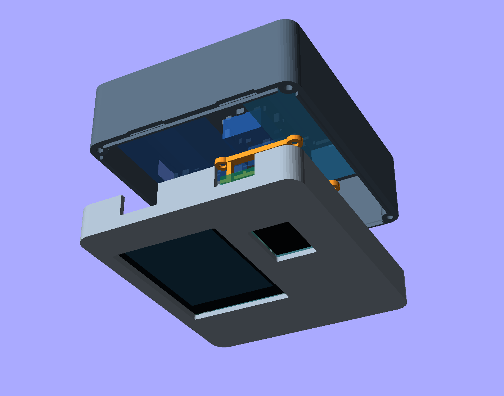
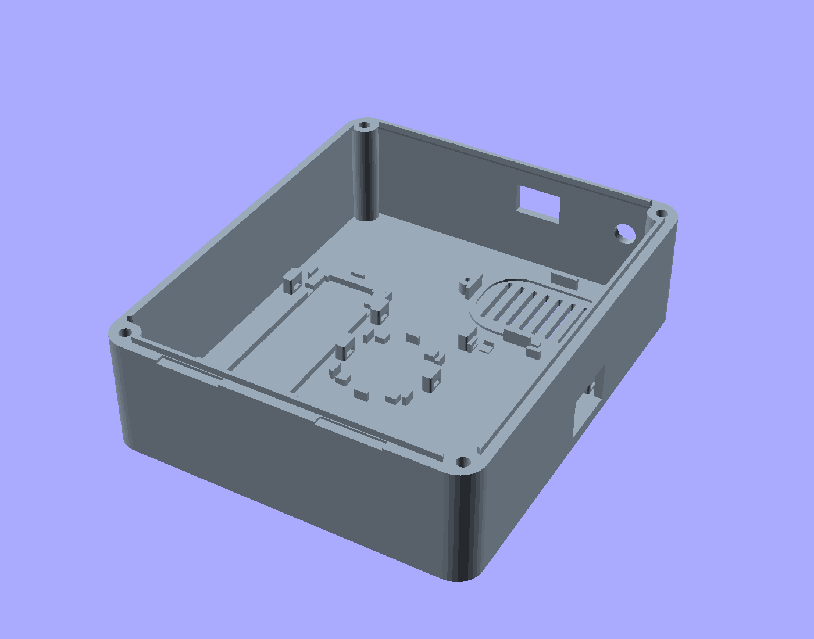

# V4 enclosure — measured parts, single battery

[OpenSCAD source](../hardware/enclosure/enclosure_v4.scad). This revision uses your component
measurements and photograph, including the confirmed **70 mm** power board and
the final **76.4 × 22.6 × 20.9 mm single-battery holder**. V3 remains available
separately in the repository.



The nominal outside shell is **104 × 124 × 50 mm**, excluding antenna and screw
heads. It includes both visible displays, the speaker, GPS patch, assembled power
board, MAX breakout and single-battery holder. The front shell is 16 mm deep;
its Heltec posts extend to 20.1 mm and GPS keepers to 20.6 mm. The rear shell is 34 mm deep plus a
1.8 mm alignment lip.

## Measurements and orientation

All dimensions are millimetres. Case X is left–right, Y runs toward the antenna
end, and Z runs from the front face toward the rear. Rotating a part changes
its X/Y footprint, not its measured size.

| Component | Your W × L × H | Case X × Y × Z |
| --- | --- | --- |
| MAX breakout | 25.45 × 20.4 × 11.35 | 20.4 × 25.45 × 11.35 |
| NEO GPS board | 36.58 × 25.93 × 11.15 | 36.58 × 25.93 × 11.15 |
| GPS antenna | 25 × 25 × 7.5 | 25 × 25 × 7.5 |
| Speaker | 40.8 × 28.2 × 10.3 | 40.8 × 28.2 × 10.3 |
| Heltec, including soldered pins | 52 × 25.7 × 15.3 | 25.7 × 52 × 15.3 |
| CYD | 86 × 50 × 9.5 | 50 × 86 × 9.5 |
| Assembled power board | 70 × 30 × 24 | 30 × 70 × 24 |
| Single-battery holder | 76.4 × 22.6 × 20.9 | 22.6 × 76.4 × 20.9 |

The charger and boost converter remain on their existing power assembly. V4
does not require separating them or reusing V3's individual module trays.

The Heltec's **15.3 mm is the complete pin-inclusive height**, used once. The
bridge underside is 1.6 mm beyond that full envelope. Its narrow feet contact
the clear outer PCB margins, outside the pin rows; verify those margins and
the actual pin/solder profile when fitting the board.

## Layout and retention



Assembly coordinates below are viewed from the front; the rear is flipped
for printing, so its inspection image reverses left and right.

| Part | Lower-left X, Y | Mount |
| --- | --- | --- |
| CYD | 7, 11 | Four PCB screw posts; screen recessed behind bezel |
| Heltec | 64, 11 | Edge supports and two removable clamps |
| GPS board | 58.5, 90.5 | Landscape, headers toward the CYD; corner keepers and a strap by the header end |
| GPS patch | 67, 90.965 | Backing-PCB ledges and two screw retainers; at least 3 mm air over ceramic |
| Power assembly | 9, 11 | Corner seats, fences and two nylon strap lanes |
| Battery holder | 72, 11 | Perimeter bed, locating fences and two strap lanes |
| MAX breakout | 45.3, 45 | Corner seats, fences and tie anchors |
| Speaker | 10, 86 | Printed rim support, floating screw retainer, wire notch and rear grille |

The battery holder has **2.2 mm** modeled clearance above the Heltec clamps.
The GPS board sits above the holder in the X/Y layout, avoiding a depth stack
between those two parts. Its PCB sits at Z=18 mm, leaving room for the antenna
carrier, rear feed connection and printed retainers. The speaker faces the rear
grille; do not run a strap across its diaphragm.
Its approximate oval support profile is adjustable with `speaker_corner_r`.

**Facing directions:** when looking at the front of the enclosure, the CYD,
Heltec OLED and GPS ceramic antenna face outward toward you. The patch is
covered by unbroken plastic with a 3 mm air gap over its ceramic face. The speaker points the opposite way, toward the
rear grille, with its magnet/back projecting into the enclosure.

## Ports and remaining fit checks

- CYD and Heltec USB remain accessible at the bottom. Their 18 × 11 mm openings
  admit a cable housing into the recess; try the actual cables on the fit coupon.
- The assembled power board's charging USB faces the left wall, with its charger
  toward the upper end as in the photograph. Its opening is 18 × 12 mm.
- The SMA bulkhead is at the top left; the switch is near the top centre.
- MicroSD, boot/reset and internal plugs are serviced by removing the rear half.

Your outside dimensions establish component envelopes, but **connector centres,
mounting-hole offsets, PCB thickness and clear edge margins were not measured**.
The CYD's 42 × 78 mm mounting pitch and glass/PCB offsets are retained from the
earlier ES3C28P drawing. Check that the measured 9.5 mm board uses those same
mounting datums before tightening it.

The power port is especially important: `power_usb_y_from_top=16` and
`power_usb_local_z=9.5` are adjustable estimates, not measurements from the photo.
The latter is measured from the outside rear face, including the PCB seat height.
Verify them and the cable housing before printing the complete case. Strap
positions are also adjustable; route straps on clear areas of the perfboard,
away from its components, sockets and adjustment controls.

Check the clear 0.8 mm PCB margins used by the Heltec clamp pads and GPS keepers.
The Heltec pads contact the PCB directly (`clamp_pad_gap=0`); adjust this datum
to the actual PCB without loading its headers or glass.
Mounts do not assume a hole pattern for the MAX, GPS or power board. The speaker
has a printed rim ledge and removable rear retainer. No mount requires foam or
adhesive.

The antenna is clamped by its **backing PCB**, not its ceramic tile. Four M2
posts and two retainer rails capture its side margins; the left rail has a coax
relief. Verify a clear 1.2 mm carrier-PCB margin and `patch_board_t` (default
1.6 mm). The support datum deliberately reserves the complete measured 7.5 mm
height in front of the backing PCB, keeping at least 3 mm clear above the
ceramic. Additional carrier/feed allowances are included behind that datum.
Check the actual feed protrusion and cable against the rear relief.

The speaker retainer has a central opening for the magnet and four feet on the
housing rim. Its screws allow it to move down until the feet just restrain the
rim; the speaker post tops are below the frame. `speaker_rim_t=2` is an initial
rim-thickness setting, not a measured flange dimension. Adjust it or the frame
opening if the housing profile differs. Keep the diaphragm and magnet clear of
the feet and do not force a screw that bottoms out.

## Export and print

Open `hardware/enclosure/enclosure_v4.scad` in OpenSCAD 2021.01 or later. `part` supports `front`,
`back`, `clamps`, `antenna_retainers`, `speaker_retainer`, `fit_coupon`,
`assembled`, `exploded`, `print_layout` and
preview-only `components`. Hardware ghosts appear in F5 Preview and are excluded
from F6 renders and STL exports.

```powershell
.\tools\export_enclosure.ps1 -Version 4
```

The exporter requires Python 3 and defaults to V4, writing binary STLs, PNGs and logs under
`build/enclosure-v4/`. In the repository, use `-Version 3` for the earlier enclosure. A bundled
prototype ZIP includes six STL files under `parts/`.

The export helper retriangulates collinear facets caused by OpenSCAD's binary
STL coordinate precision. It checks that this preserves every vertex, the
surface area, volume and closed edges; it does not move or resize parts.

1. Print the **fit coupon first**. Check the actual CYD post spacing/height,
   USB plug entry and screw/insert fit. Gauge holes are 2.6 / 3.4 / 4.2 mm,
   left to right. A successful coupon does not verify the other modules.
2. Suggested starting settings: PETG, 0.2 mm layers, 4 perimeters, 5 solid top
   and bottom layers, 20–30% infill. Parts export in bed orientation. Inspect
   USB bridges, raised tie tunnels, GPS keeper overhangs and tall clamp pads in
   your slicer; add local support where your printer needs it.
3. Use **4 M3 × 6 mm pan-head screws** for the CYD, **4 M3 × 8 mm countersunk
   screws** for the Heltec clamps, and **4 M3 × 40 mm screws** for the case.
   The antenna rails use **4 M2 × 8 mm countersunk screws**, and the speaker
   frame uses **2 M2 × 8 mm countersunk screws**. The printed M2 pilots are
   1.6 mm; tap them if needed. Check actual head diameters against the retainers.
   Tap the printed pilots as needed. Flush clamp screw heads leave the battery
   space clear. The default case screws engage about 7 mm of the front pilots.
4. Optional `case_fastener="heatset"` provides 4.2 mm diameter × 4.5 mm deep
   insert pockets. Measure your inserts and adjust these values first. M3 × 40
   also clears the blind-hole bottom in the default 50 mm case. Changing case
   depth changes screw length; OpenSCAD echoes a suggested length and engagement.
5. Secure the holder and intact power board with narrow nylon straps through
   their raised anchors and underside channels. Put locking heads away from
   clamps, USB entry, solder joints and cables. Fit the antenna backing PCB onto
   its ledges and install its two retainer rails before fitting the GPS receiver
   above it. Place the speaker sound face toward the rear grille and fit its
   floating retainer over the magnet. Keep the ceramic face, its air gap and
   the speaker diaphragm clear. No foam or adhesive is used.
6. With the battery disconnected, check all plug bodies, wire bends, solder
   clearance, switch latches, SMA nut/pigtail and the closed-case fit. The source
   envelopes do not include loose wire loops. The CYD USB still does not charge
   the battery; use the separate power-board charging connection.

## Single job on a 180 × 180 mm bed

The direct STL `hardware/enclosure/enclosure-v4-all-parts-180mm.stl` contains all **seven assembly
pieces**: both shells, two Heltec clamp bars, two GPS antenna rails and the
speaker frame. The optional fit coupon is separate. This layout preserves
the measured dimensions at 100% scale. Both shells stand on their lower edges
to fit together; all loose retainers remain flat. Its model bounds are
164.8 × 115 × 124 mm, with at least 7 mm free around the bed boundary.

Import as **millimetres**, keep **100% scale** and the supplied orientation and
positions. Disable automatic arrangement or rotation onto the largest face.
Enable **supports everywhere**, including internal posts and mounting ledges,
and a **5 mm brim**. Keep generated support/brim paths within the 180 mm bed
in the slicer preview. The printer needs at least 124 mm of usable Z travel.
Supports are generated by the slicer; the STL does not contain supports.
Inspect their access through the open shells before printing. This one-job
orientation uses more support and cleanup than printing the shells flat in
separate jobs; it has not been physically test printed.

The export helper also generates this STL under `build/enclosure-v4/`.
To regenerate only the layout from existing part exports:

```powershell
python tools/layout_enclosure_plate.py --output hardware/enclosure/enclosure-v4-all-parts-180mm.stl
```

The layout tool checks closed edges, winding, positive volume, seven separate
bodies, face contact with the bed for each body, nonoverlapping part groups,
bed margins and unchanged material volume. These checks do not verify slicer
support generation or print quality.

## Validation scope

Component envelopes include the measured heights, switch body and an SMA
allowance. OpenSCAD checks their bounds and mutual separation, plus the
battery/clamp gap. The hidden `part="interference"` checks the front, Heltec
clamps and antenna rails against the rear and speaker frame, with 0.05 mm axial
separation to discard seam contact.

The six default binary STL exports passed closed-edge, winding, positive-volume,
body-count and bed-contact checks, with no degenerate facets after export
normalization. The final interference diagnostic produced no solid output.
The checks include the printed retainer geometry, but do not replace checking
the unmeasured PCB margins and speaker rim against the actual components.

CAD and mesh checks establish printable geometry; they do not establish physical
fit, thermal performance, RF reception or impact resistance. The enclosure has
USB and speaker openings and is not sealed. Port offsets and mount contact
areas still need the fit checks above.

## Plastic and GPS signal

Plain, unfilled plastic is a suitable starting point for the cover, but proximity
to dielectric material can change antenna tuning; zero signal impact is not
assumed. V4 leaves **3 mm of air above the ceramic face** and 10 mm horizontally
to the CYD envelope. The gap is not filled with foam. Keep conductive coatings,
metal and conductive-filled filament out of this area.

The 3 mm spacing follows [Quectel's general GNSS antenna guidance](https://quectel.com/content/uploads/2024/04/Quectel_GNSS_Antenna_Application_Note_V1.0.pdf),
section 4.2.3. This is a design baseline, not the specification of your unidentified
25 mm antenna. With the final material, compare reception outdoors with the case
open and closed, using the same orientation and sky view. The front-facing patch
has its best view of the sky when the front of the unit faces upward; a vertical
handheld orientation and the user's body can also affect reception.
